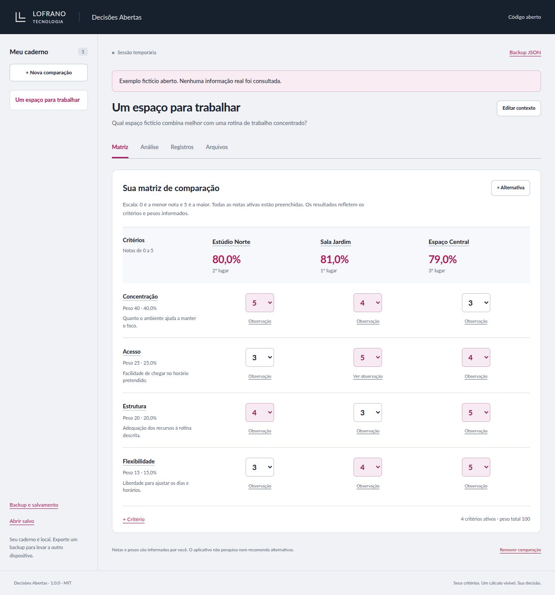

# Decisões Abertas

Compare alternativas com critérios, pesos e notas que você define. Veja a contribuição de cada critério, perceba o que falta responder e registre a sua escolha com uma justificativa. A pontuação ajuda a explicar a comparação; a decisão continua com você.

**Notas ausentes permanecem ausentes.** O ranking só aparece quando todas as alternativas têm notas em todos os critérios ativos. A ferramenta funciona no navegador, começa vazia e usa uma sessão temporária até você optar pelo salvamento local.

[Abrir aplicação](https://martinlofranodeoliveira.github.io/decisoes-abertas/) · [LOFRANO TECNOLOGIA](https://lofranotecnologia.com.br) · [Licença MIT](LICENSE)



[Ver a matriz no celular](docs/images/matriz-mobile.png).

## Faça uma comparação

1. Selecione **Criar comparação** e escreva o título e a pergunta que pretende responder.
2. Na aba **Matriz**, adicione os critérios e seus pesos relativos, de `0` a `100`. Os pesos não precisam somar `100`; peso zero deixa o critério fora do cálculo, preservando suas notas e observações. Clique no nome de um critério para editar seu peso e a descrição da escala.
3. Adicione as alternativas. Para cada par alternativa × critério, dê uma nota inteira de `0` a `5` ou mantenha a resposta ausente. Use notas maiores para condições que considera mais favoráveis e descreva o significado da escala nos critérios. **Zero é uma nota, não uma resposta em branco.**
4. Abra **Análise** para consultar as contribuições e os resultados explicados. Enquanto houver respostas ativas ausentes, a aplicação mostra a cobertura e um intervalo de pontuação possível, sem ordenar alternativas por um ranking incompleto.
5. Em **Sua conclusão**, registre a alternativa escolhida e sua justificativa e selecione **Salvar conclusão**, inclusive quando sua escolha difere da maior pontuação.
6. Na aba **Registros**, selecione **Criar registro** para preservar a matriz usada naquele momento. Edições posteriores não modificam esse registro. **Ver registro** abre a cópia histórica.

Você também pode selecionar **Explorar exemplo fictício** na tela inicial. Estúdio Norte, Sala Jardim e Espaço Central são nomes inventados para demonstrar a escolha de um espaço de trabalho, sem referência a locais ou ofertas reais.

Os mesmos dados estão disponíveis como [backup JSON de exemplo](examples/caderno-exemplo.json), [notas em CSV](examples/notas.csv) e [relatório Markdown](examples/comparacao.md). Para abrir o JSON baixado, entre em **Arquivos**, escolha o **Arquivo JSON** e confira a prévia antes de selecionar **Substituir pelo backup**.

## Entenda a pontuação

Para cada alternativa, a aplicação soma `nota × peso` nos critérios ativos. O total possível é `5 × soma dos pesos ativos`.

Por exemplo, com pesos `40` e `60`, notas `5` e `3` produzem `5 × 40 + 3 × 60 = 380` pontos de `500`, ou **76,0%**. Os percentuais são exibidos com uma casa decimal; os cálculos e a comparação de posições usam os valores inteiros antes desse arredondamento.

- Uma nota ausente não vira zero e não reduz o denominador daquela alternativa.
- O intervalo mostrado com lacunas vai do total já conhecido ao total possível se as notas ausentes fossem `5`. É um intervalo aritmético, não uma previsão.
- Critérios de peso zero não bloqueiam o ranking.
- Sem critérios ativos ou sem alternativas, não há ranking.
- Empates mantêm a mesma posição, como `1, 1, 3`, e são indicados explicitamente.

A ferramenta organiza as informações fornecidas. Não consulta fontes externas nem verifica a qualidade das notas ou dos critérios escolhidos.

## Guarde e compartilhe

| Formato | Conteúdo | Pode ser restaurado na aplicação? |
| --- | --- | --- |
| Backup JSON | Todas as comparações, matrizes, escolhas e registros históricos | Sim, com prévia antes de substituir o caderno em memória |
| Markdown | Relatório legível de uma comparação ou de uma matriz histórica selecionada | Não |
| CSV | Uma linha por par alternativa × critério da comparação exportada | Não |

Na aba **Arquivos**, use **Baixar backup JSON**, **Exportar Markdown** ou **Exportar notas CSV**. O atalho **Backup e salvamento** do menu também abre essa área. Os arquivos são gerados como downloads locais. Não há importação CSV nesta versão. O CSV aplica proteção a textos que uma planilha poderia interpretar como fórmulas; a transformação está documentada em [docs/FORMATO.md](docs/FORMATO.md).

O backup JSON é a forma de levar seu caderno a outro navegador ou dispositivo. Registros históricos são cópias editáveis no próprio arquivo de backup, sem assinatura digital ou garantia contra alteração externa.

### Salvamento neste navegador

Por padrão, a aplicação não abre o armazenamento nem salva suas comparações. Para persistir o caderno, use **Ativar salvamento** em **Arquivos**. Para recuperar um caderno já guardado nesta origem, selecione **Abrir salvo**. Se houver outro caderno no armazenamento, a aplicação oferece abri-lo ou cancelar, sem substituí-lo silenciosamente.

Com o salvamento habilitado, as edições são gravadas em IndexedDB. Uma falha de armazenamento ou um conflito com outra aba interrompe novas gravações automáticas e mantém o caderno em memória para que você possa exportar um backup. A aplicação não força a substituição de uma revisão mais recente.

O salvamento pertence à origem e ao perfil do navegador. Não sincroniza dispositivos; a limpeza dos dados do site pode removê-lo. Exporte backups dos cadernos que pretende conservar. **Desativar e apagar salvamento** exige confirmação e mantém a sessão atual em memória.

## Execute no seu computador

Requisitos: **Node.js 22 ou superior**, npm e Git.

```sh
git clone https://github.com/martinlofranodeoliveira/decisoes-abertas.git
cd decisoes-abertas
npm ci
npm run dev
```

Abra o endereço local informado no terminal. Os módulos JavaScript devem ser servidos por HTTP; abrir `index.html` diretamente por `file://` não é o fluxo suportado.

Para verificar e preparar os arquivos estáticos:

```sh
npm test
npm run build
npm run check
npm run preview
```

O build gera `dist/`, que pode ser publicado como site estático. Execute o build antes de `check` e `preview`, pois esses comandos usam a saída gerada. Não há backend de negócio, conta de usuário, chave de API, serviço de IA ou publicação do pacote no npm. O navegador usa os arquivos estáticos e as fontes locais do projeto, sem dependências de execução externas à aplicação.

## Limites

| Elemento | Limite |
| --- | ---: |
| Comparações por caderno | 20 |
| Alternativas por comparação | 8 |
| Critérios por comparação | 12 |
| Registros históricos por comparação | 12 |
| Nota | Inteiro de 0 a 5, ou ausente |
| Peso relativo | Inteiro de 0 a 100 |
| Backup JSON canônico | 2 MiB em UTF-8 |

Importações inválidas ou acima dos limites preservam o caderno anterior. Remover uma alternativa escolhida limpa a referência da escolha, mas mantém a justificativa textual para revisão. Os registros históricos conservam suas próprias alternativas e valores anteriores.

## Desenvolvimento e personalização

- [SPEC.md](SPEC.md) descreve o contrato de domínio, comandos, cálculo e armazenamento.
- [docs/FORMATO.md](docs/FORMATO.md) detalha o backup JSON e as exportações.
- [PRODUCT.md](PRODUCT.md) registra a finalidade e os princípios do produto.
- [CONTRIBUTING.md](CONTRIBUTING.md) orienta contribuições e verificações.
- [SECURITY.md](SECURITY.md) explica o tratamento local dos dados e como relatar problemas.
- [THIRD_PARTY_NOTICES.md](THIRD_PARTY_NOTICES.md) identifica a fonte Lato e as ferramentas de desenvolvimento.

O código e a documentação usam a licença MIT. Preserve os avisos de autoria e as licenças dos recursos de terceiros ao reutilizar o projeto. A interface e a infraestrutura seguem a família de aplicativos abertos da LOFRANO TECNOLOGIA.
